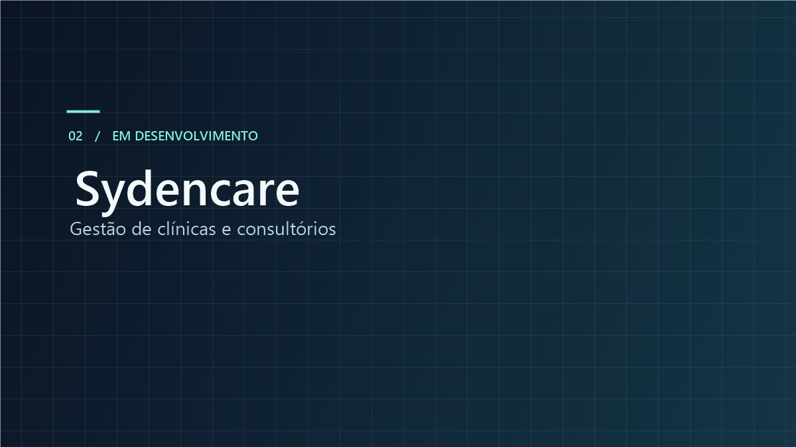
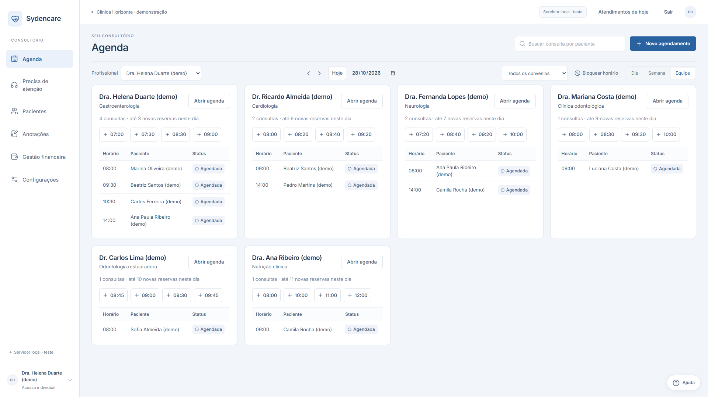

# Sydencare

**Plataforma de gestão de clínicas e consultórios em desenvolvimento.**

[Portfólio de Pedro Henrique Bertone](https://github.com/Sydenci#projetos) · [Demonstração documentada](docs/demonstracao.md) · [Contato profissional](https://www.linkedin.com/in/pedro-bertone-0890822b5/)

## O problema

A rotina de uma clínica reúne horários de diferentes profissionais, informações de pacientes, registros de atendimento e controles administrativos. O Sydencare organiza esses fluxos em uma mesma aplicação, com acesso conforme as permissões de cada perfil.

## Funcionalidades implementadas

- Agenda diária, semanal e por equipe, com criação, remarcação e cancelamento de consultas.
- Busca de pacientes, ficha com histórico de consultas, prontuário e consulta de documentos anexados.
- Modelos de formulário com tipos de campo configuráveis por profissional e preenchimento no atendimento.
- Controle de acesso por perfil.
- Gestão financeira com registro manual de recebimentos e despesas.

## Simulação local e evolução

O projeto também dispõe de um simulador local de atendimento, com escolha de profissional, data e horário conforme as regras da agenda. As mensagens exibidas pertencem ao ambiente de desenvolvimento local. A conexão com a API oficial do WhatsApp está fora do escopo demonstrado.

**O produto permanece em desenvolvimento.** O escopo implementado está documentado acima e nas capturas. O planejamento de próximas funcionalidades ainda não está publicado neste portfólio.

## Minha participação

Atuo na concepção e na evolução do sistema, organizando requisitos, funcionalidades e testes. O desenvolvimento é apoiado por ferramentas de inteligência artificial, com conferência dos fluxos e aprimoramento da experiência de uso.

## Demonstração

*Ambiente local de teste, com dados sintéticos. As demais capturas apresentam prontuário demonstrativo, editor de formulários, resumo financeiro e simulador.*

[Ver as cinco capturas e seus contextos](docs/demonstracao.md)

## Tecnologias do projeto

React · TypeScript · Tauri

## Sobre este repositório

Repositório público de apresentação do projeto, com documentação e capturas demonstrativas. A aplicação e seu código-fonte têm distribuição privada.

**Autoria — Pedro Henrique Bertone**

[LinkedIn](https://www.linkedin.com/in/pedro-bertone-0890822b5/) · [E-mail](mailto:pedrohbertone@outlook.com)
