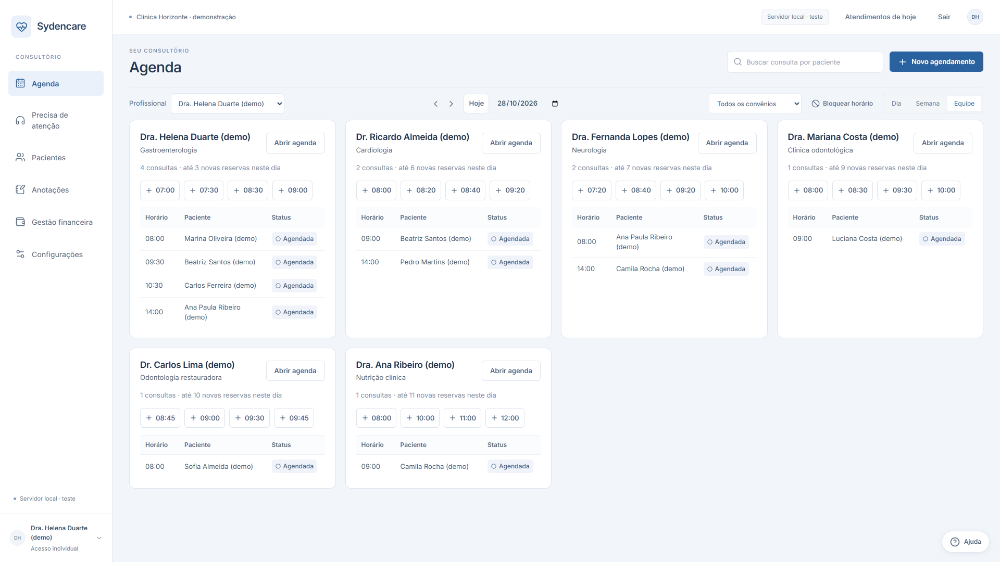
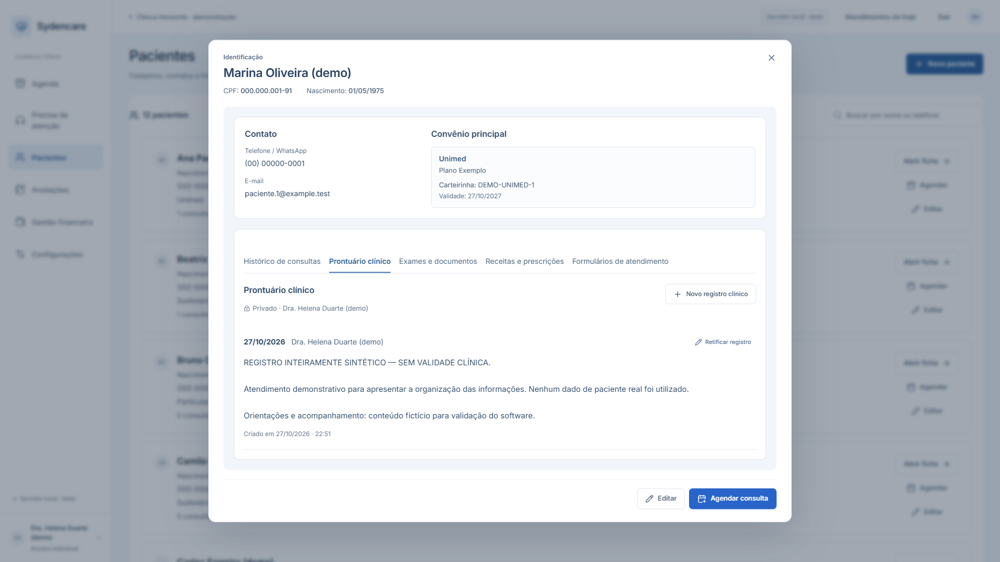
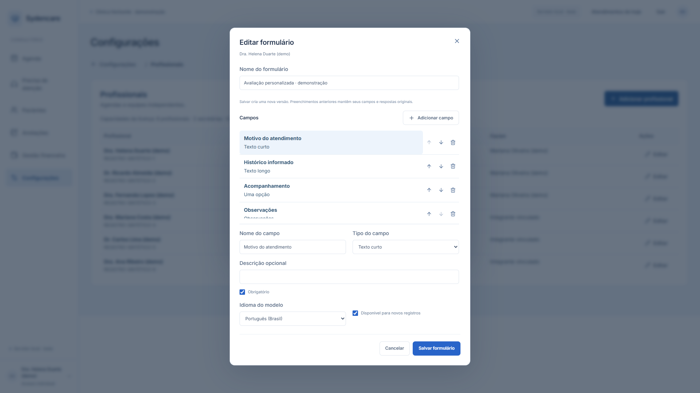
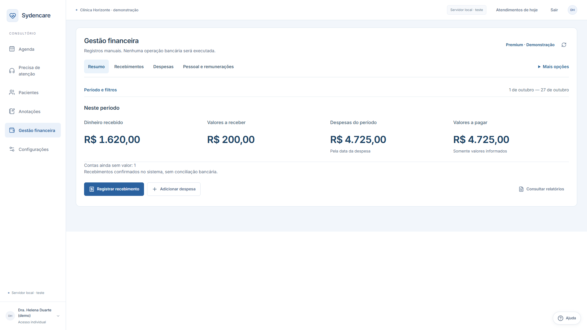
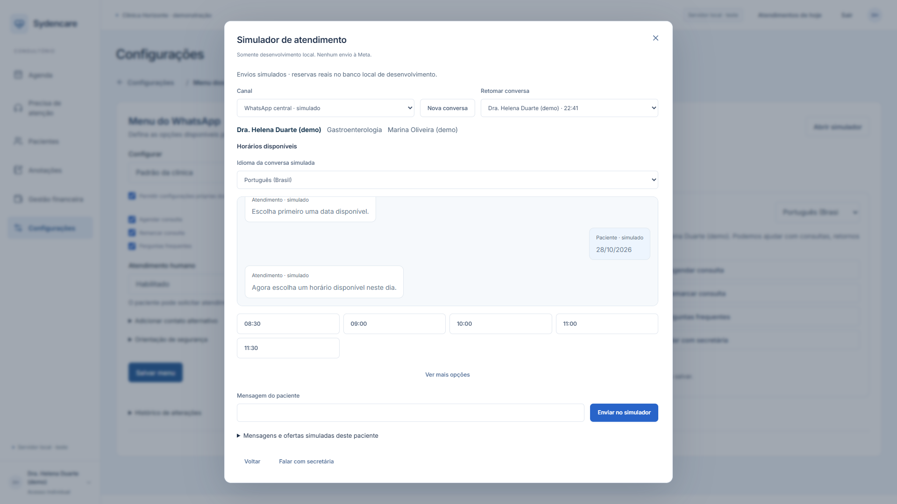

# Demonstração do Sydencare

[Voltar à apresentação](../README.md)

As imagens pertencem ao catálogo demonstrativo de outubro de 2026, registrado no Chrome local com dados sintéticos. Pacientes, profissionais, registros clínicos e valores financeiros são exemplos de teste.

## Agenda da equipe

Visão conjunta das agendas dos profissionais, horários e estados dos atendimentos. A captura identifica a clínica, os profissionais e os pacientes como demonstração.

## Prontuário clínico demonstrativo

A ficha reúne histórico, prontuário, documentos e formulários em abas. O registro clínico exibido é inteiramente sintético e está identificado como demonstração na própria tela. Os dados de identificação e contato são fictícios.

## Editor de formulários

O editor permite organizar tipos de campo, ordem e preenchimento obrigatório em um modelo de atendimento. A tela também informa a criação de versões para preservar preenchimentos anteriores.

## Resumo financeiro

A tela separa recebimentos registrados, valores a receber, despesas e contas a pagar. Os valores são fictícios e representam registros manuais do ambiente de demonstração.

## Simulador de atendimento

Fluxo de escolha de data e horário em uma conversa simulada no ambiente local de desenvolvimento. A captura identifica o canal como simulado e informa que nenhum envio é realizado à Meta.

## Recursos demonstrados e planejamento

| Situação | Escopo |
| --- | --- |
| Implementado | Agenda, ficha do paciente, prontuário, formulários configuráveis, controle de acesso por perfil e registros financeiros manuais. |
| Implementado em ambiente local | Simulador de atendimento e seleção de horários. |
| Planejamento | Próximas funcionalidades ainda não apresentadas neste portfólio. |

A apresentação acompanha um produto em desenvolvimento. O simulador documenta a experiência local de atendimento, e a integração com a API oficial do WhatsApp permanece fora do escopo demonstrado.
